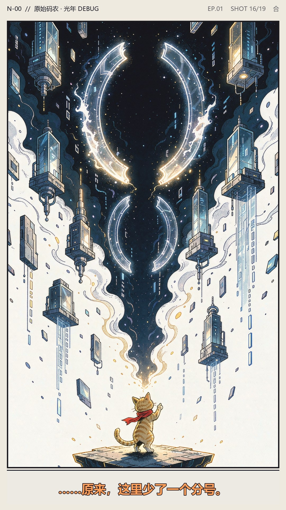

# 光年 Debug · 原始码农

一部 108 秒的 9:16 竖屏赛博朋克漫剧短片，以漫画分格视觉与动态镜头讲述一只橘猫「原始码农」求职失败后，在光年尺度上补完宇宙循环里缺失的那个分号。



## 观看方式

- **在线播放**：开启 GitHub Pages 后访问 `https://jiaying-feng.github.io/lightyear-debug/`，或直接打开仓库里的 [index.html](index.html)（内嵌播放器）。
- **下载成片**：[lightyear-debug.mp4](lightyear-debug.mp4)（72 MB，1080×1920，H.264 + AAC）。
- **关键帧**：[stills/](stills/) 共 9 张。

## 成片规格

| 项目 | 参数 |
| --- | --- |
| 时长 | 1:48（108 秒） |
| 画幅 | 1080 × 1920，9:16 竖屏 |
| 帧率 / 编码 | 24 fps，H.264，AAC 立体声 |
| 结构 | 5 场景、19 镜、起承转合四段 |
| 音频 | 12 句中文配音、15 类共 28 个音效事件、4 段 BGM |
| 字幕 | 12 条，硬字幕已烧录，另附 SRT |

## 目录说明

```
index.html            交付总览页（内嵌播放器 + 四张表汇总）
lightyear-debug.mp4   成片
cover.jpg             封面
stills/               9 张关键帧静图
docs/
  01-default-settings.md   默认设定与可替换项
  02-storyboard.md         分镜表（时间码 / 版面 / 运镜 / 转场 / 音效）
  03-subtitle-timeline.md  字幕时间轴
  04-audio-list.md         音频清单（配音 / 音效 / BGM / 混音规格）
  subtitles.srt            SRT 字幕文件
```

## 制作方式

- 画面：16 张统一风格原画，共用同一画风前缀与角色描述锚点，保证造型与线条一致；平台水印在渲染前统一裁除。
- 动态：本地逐帧渲染分格版面、Ken Burns 运镜、格子依次显现、转场与硬字幕，再由 ffmpeg 编码。屏内代码与 UI 文字由渲染器绘制，不交给绘画模型，避免乱码。
- 音频：中文 TTS 配音 + 程序化合成雨声、电流、键盘、扫描、低频冲击等音效与 synth pad BGM，无外部素材依赖。

> **人工审校说明**：本片属 AI 辅助生成作品。剧本、分镜编排、字幕时间轴、音频清单与成片抽帧结果均经人工逐项复核；画面素材由图像模型生成后统一裁切与一致性检查，配音与音效由本地程序合成并按时间轴混音。所有默认设定与台词均标注为可替换项，见 `docs/01-default-settings.md`。

## 可替换项

片名、主角、对手、道具、画风、色值、时长、声线与台词均可替换，集中在 `docs/01-default-settings.md`。修改后按分镜表与字幕时间轴同步更新即可重出一版。
